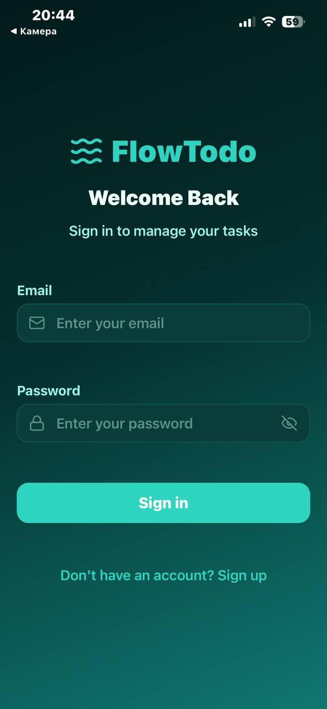
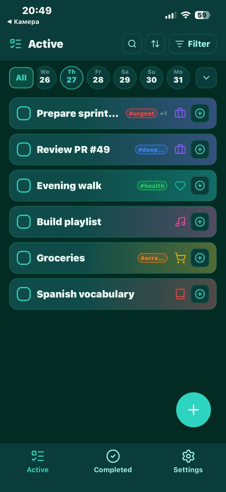
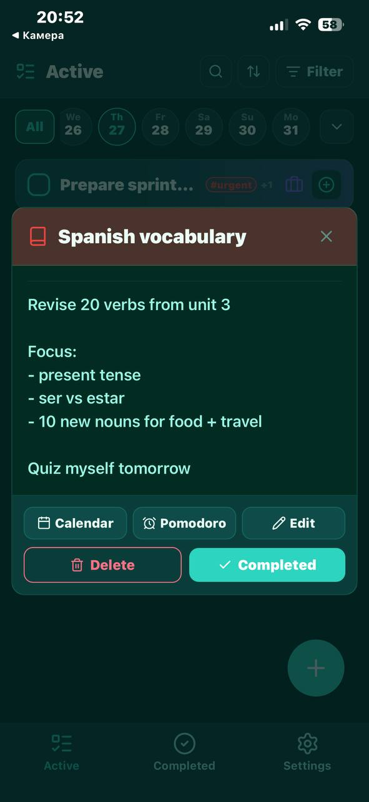
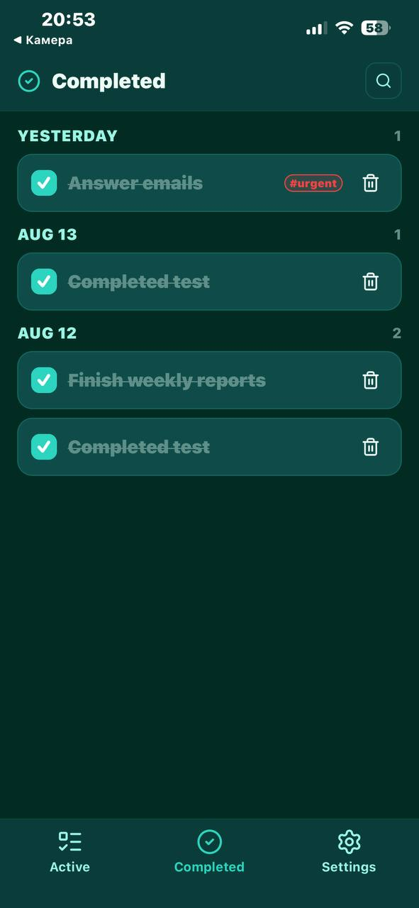
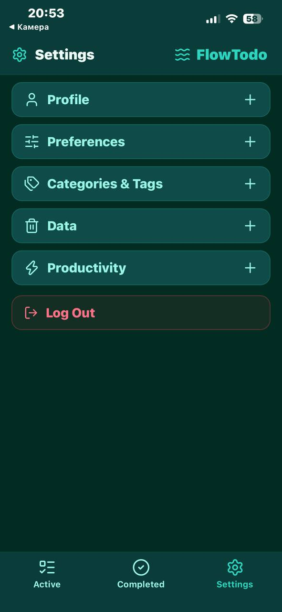
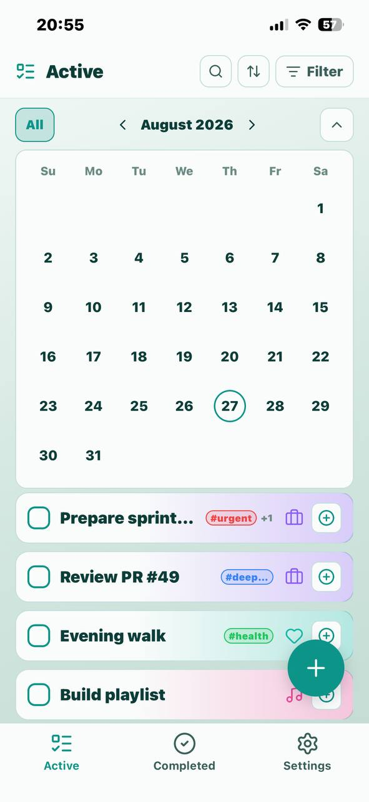

# FlowTodo

**English** · [Polski](README.pl.md) · [Українська](README.ua.md)

A port of [NextTodo](https://github.com/matt400/NextTodo) to **Expo (React Native)** + **Supabase**: iOS, Android and web from a single codebase.

**Live (web):** [flowtodo-expo-supabase.vercel.app](https://flowtodo-expo-supabase.vercel.app)  
**v1.0.1:** [Release](https://github.com/ep1cvoice/flowtodo-expo-supabase/releases/tag/v1.0.1) (the APK is attached to the release).

## Screenshots

| | |
|:--|:--|
|  |  |
| *Log in* | *Active* |
|  |  |
| *Task detail* | *Completed* |
|  |  |
| *Settings* | *Active (light)* |

## Status

**v1.0**: the core flow is wired to Supabase (auth, tasks, Pomodoro, settings).

| Area | State |
|------|-------|
| Auth (login / register / session) | Supabase Auth + `profiles` |
| Change password / delete account | Settings + `delete_own_account` RPC |
| Theme + Pomodoro duration | Stored in `profiles` |
| Tasks / categories / tags | Supabase + RLS; demo seed for new users |
| Pomodoro timer + history | `pomodoros` table + UI |
| Splash screen | Brand overlay on session start |
| Drag & drop / reorder | Native: long-press; web: ↑/↓; `sort_order` in the DB |
| Toasts | Global `ToastContext` / `ToastHost` |
| Haptics | Drag, complete, delete (native) |
| Network awareness | Offline banner + refetch on reconnect; network toasts |

## Stack

| Layer | Choice |
|-------|--------|
| Framework | Expo SDK **57** + Expo Router |
| Package manager | **Bun** (`bun.lock`); Node.js LTS is still needed for some Expo commands |
| UI | React Native + `react-native-web`, StyleSheet |
| Icons | `lucide-react-native` |
| Auth / DB | Supabase (`supabase-js`), session in AsyncStorage |
| Gestures / DnD | `gesture-handler`, `reanimated`, `react-native-sortables` |
| Feedback | `expo-haptics`, custom toasts |
| Sound | `expo-av` (Pomodoro alarm) |

## Supabase migrations

Order in `supabase/migrations/`:

1. `20260802120000_profiles.sql`: profile + settings
2. `20260807120000_tasks_domain.sql`: tasks / categories / tags + RLS
3. `20260807120100_grants.sql`: grants for `authenticated`
4. `20260808120000_delete_own_account.sql`: account deletion RPC
5. `20260810120000_pomodoros.sql`: Pomodoro sessions and history
6. `20260812120000_tasks_completed_at.sql`: `completed_at` on tasks
7. `20260812120100_filter_limits.sql`: shared filter limit (`max_filter_selections`, 5–30)

On a fresh database, run the migrations in this order (SQL Editor or CLI).

## Run

Install [Bun](https://bun.sh/docs/installation), then:

```bash
bun install
cp .env.example .env   # fill in your keys locally
bun start -- -c
```

`w` = web · Expo Go = scan the QR code from the terminal · SDK **57** on purpose, to match the current Expo Go.

| Task | Command |
|------|---------|
| Dev server | `bun start` |
| Android | `bun run android` |
| iOS | `bun run ios` |
| Web | `bun run web` |
| Add an Expo library | `bun expo install <pkg>` |

## Android APK

```bash
bunx eas-cli login
bunx eas-cli build:configure   # once: links the Expo projectId into app.json
bunx eas-cli env:set preview --name EXPO_PUBLIC_SUPABASE_URL --value "https://YOUR.supabase.co" --visibility plaintext --non-interactive
bunx eas-cli env:set preview --name EXPO_PUBLIC_SUPABASE_ANON_KEY --value "your_anon_key" --visibility sensitive --non-interactive
bunx eas-cli build -p android --profile preview
```

The `preview` profile in `eas.json` builds an **APK** (not an AAB). After the build, Expo gives you a download link; on the phone you need to allow installs from unknown sources. EAS uses Bun because the repo has a `bun.lock`.

## Web (Vercel)

A push to `main` triggers a deploy. Vercel env vars (build time): `EXPO_PUBLIC_SUPABASE_URL`, `EXPO_PUBLIC_SUPABASE_ANON_KEY`. Config: `vercel.json`.

## Tests

```bash
bun run test
```

Use `bun run test`, not `bun test`: that one is Bun's own runner, not Jest.

Stack: **Jest** + **jest-expo** + **@testing-library/react-native**.  
Current must-have coverage: auth validation (+ login smoke test), network errors, task/Pomodoro mappers, filtered reorder, offline banner.
