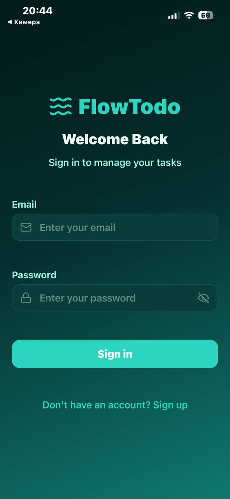
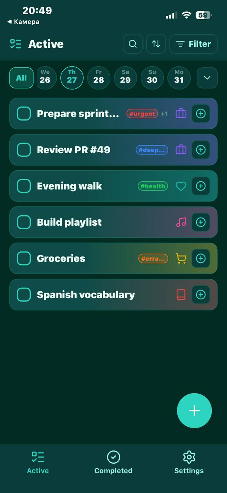
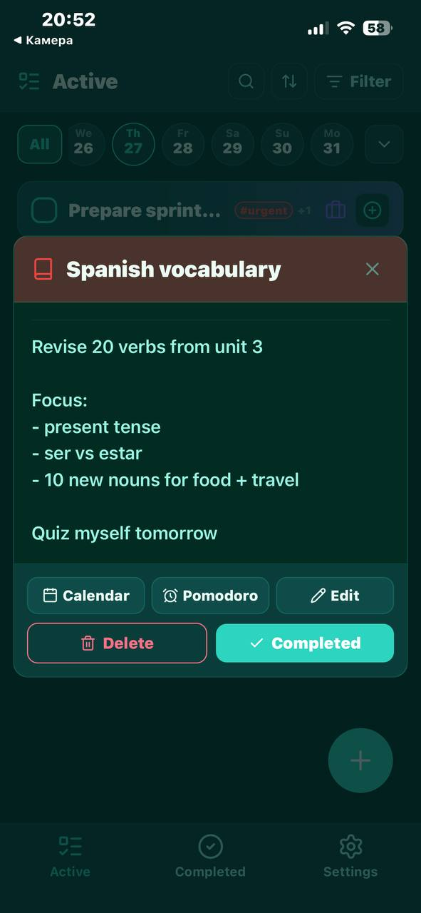
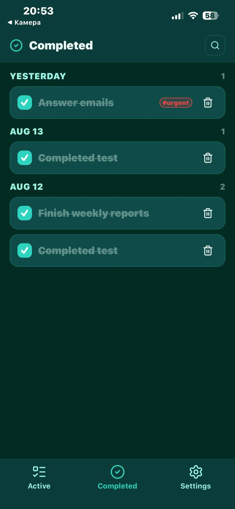
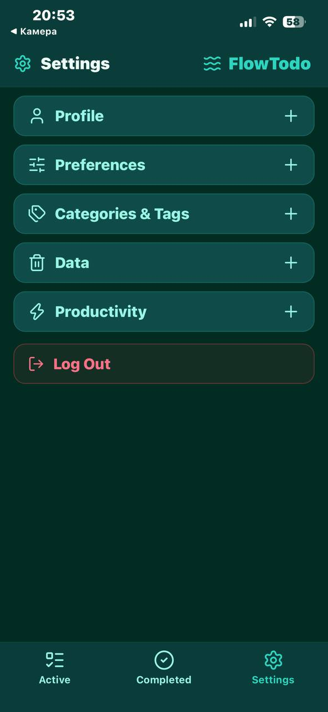
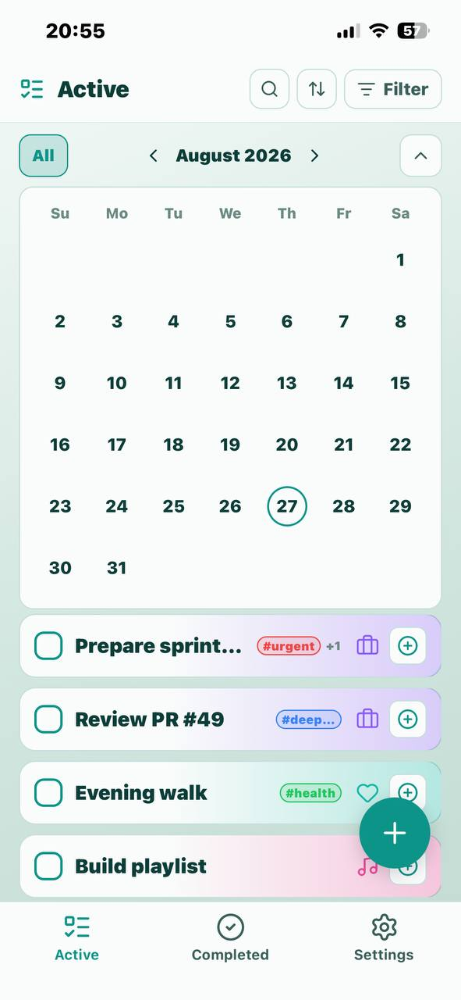

# FlowTodo

[English](README.md) · **Polski** · [Українська](README.ua.md)

Port [NextTodo](https://github.com/matt400/NextTodo) na **Expo (React Native)** + **Supabase**: iOS, Android i web z jednej bazy kodu.

**Live (web):** [flowtodo-expo-supabase.vercel.app](https://flowtodo-expo-supabase.vercel.app)  
**v1.0.1:** [Release](https://github.com/ep1cvoice/flowtodo-expo-supabase/releases/tag/v1.0.1) (APK w załącznikach release'u).

## Zrzuty ekranu

| | |
|:--|:--|
|  |  |
| *Logowanie* | *Aktywne* |
|  |  |
| *Szczegóły zadania* | *Ukończone* |
|  |  |
| *Ustawienia* | *Aktywne (jasny motyw)* |

## Status

**v1.0**: główny przepływ jest spięty z Supabase (auth, zadania, Pomodoro, ustawienia).

| Obszar | Stan |
|--------|------|
| Auth (logowanie / rejestracja / sesja) | Supabase Auth + `profiles` |
| Zmiana hasła / usunięcie konta | Ustawienia + RPC `delete_own_account` |
| Motyw + długość Pomodoro | Zapis w `profiles` |
| Zadania / kategorie / tagi | Supabase + RLS; dane demo dla nowych użytkowników |
| Timer Pomodoro + historia | Tabela `pomodoros` + UI |
| Ekran startowy | Nakładka z logo przy starcie sesji |
| Przeciąganie / zmiana kolejności | Natywnie: długie przytrzymanie; web: ↑/↓; `sort_order` w bazie |
| Toasty | Globalny `ToastContext` / `ToastHost` |
| Haptyka | Przeciąganie, ukończenie, usunięcie (natywnie) |
| Obsługa sieci | Baner offline + odświeżenie po powrocie sieci; toasty o sieci |

## Stack

| Warstwa | Wybór |
|---------|-------|
| Framework | Expo SDK **57** + Expo Router |
| Menedżer pakietów | **Bun** (`bun.lock`); Node.js LTS nadal potrzebny do części komend Expo |
| UI | React Native + `react-native-web`, StyleSheet |
| Ikony | `lucide-react-native` |
| Auth / baza | Supabase (`supabase-js`), sesja w AsyncStorage |
| Gesty / DnD | `gesture-handler`, `reanimated`, `react-native-sortables` |
| Informacja zwrotna | `expo-haptics`, własne toasty |
| Dźwięk | `expo-av` (alarm Pomodoro) |

## Migracje Supabase

Kolejność w `supabase/migrations/`:

1. `001_profiles.sql`: profil + ustawienia
2. `002_tasks_domain.sql`: zadania / kategorie / tagi + RLS
3. `003_grants.sql`: uprawnienia (GRANT) dla `authenticated`
4. `004_delete_own_account.sql`: RPC usuwania konta
5. `005_pomodoros.sql`: sesje i historia Pomodoro
6. `006_tasks_completed_at.sql`: `completed_at` w zadaniach
7. `007_filter_limits.sql`: wspólny limit filtrów (`max_filter_selections`, 5–30)

Na świeżej bazie uruchom migracje w tej kolejności (SQL Editor albo CLI).

## Uruchomienie

Zainstaluj [Bun](https://bun.sh/docs/installation), potem:

```bash
bun install
cp .env.example .env   # uzupełnij klucze lokalnie
bun start -- -c
```

`w` = web · Expo Go = kod QR z terminala · SDK celowo **57**, pod aktualne Expo Go.

| Zadanie | Komenda |
|---------|---------|
| Serwer deweloperski | `bun start` |
| Android | `bun run android` |
| iOS | `bun run ios` |
| Web | `bun run web` |
| Dodanie biblioteki Expo | `bun expo install <pkg>` |

## APK na Androida

```bash
bunx eas-cli login
bunx eas-cli build:configure   # raz: wpisuje projectId Expo do app.json
bunx eas-cli env:set preview --name EXPO_PUBLIC_SUPABASE_URL --value "https://YOUR.supabase.co" --visibility plaintext --non-interactive
bunx eas-cli env:set preview --name EXPO_PUBLIC_SUPABASE_ANON_KEY --value "your_anon_key" --visibility sensitive --non-interactive
bunx eas-cli build -p android --profile preview
```

Profil `preview` w `eas.json` buduje **APK** (nie AAB). Po buildzie Expo daje link do pobrania; na telefonie trzeba zezwolić na instalację z nieznanych źródeł. EAS używa Buna, bo w repo jest `bun.lock`.

## Web (Vercel)

Push na `main` uruchamia deploy. Zmienne środowiskowe na Vercelu (w czasie buildu): `EXPO_PUBLIC_SUPABASE_URL`, `EXPO_PUBLIC_SUPABASE_ANON_KEY`. Konfiguracja: `vercel.json`.

## Testy

```bash
bun run test
```

Używaj `bun run test`, nie `bun test`: to drugie to własny runner Buna, nie Jest.

Stack: **Jest** + **jest-expo** + **@testing-library/react-native**.  
Obowiązkowe pokrycie na teraz: walidacja auth (+ smoke test logowania), błędy sieci, mapery zadań i Pomodoro, zmiana kolejności przy filtrach, baner offline.
