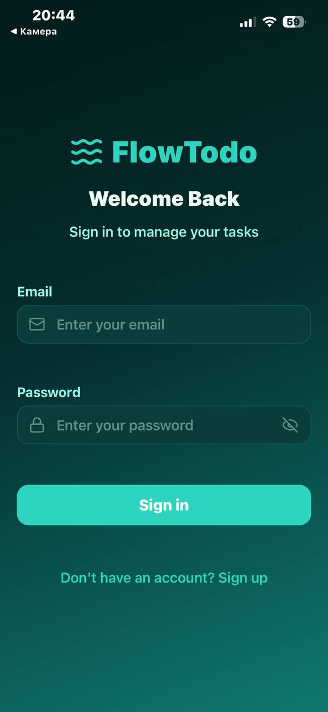
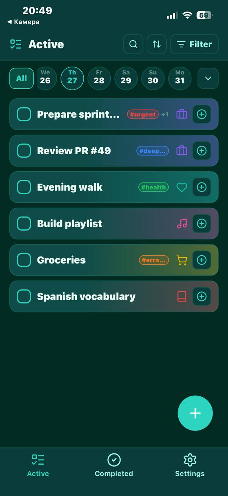
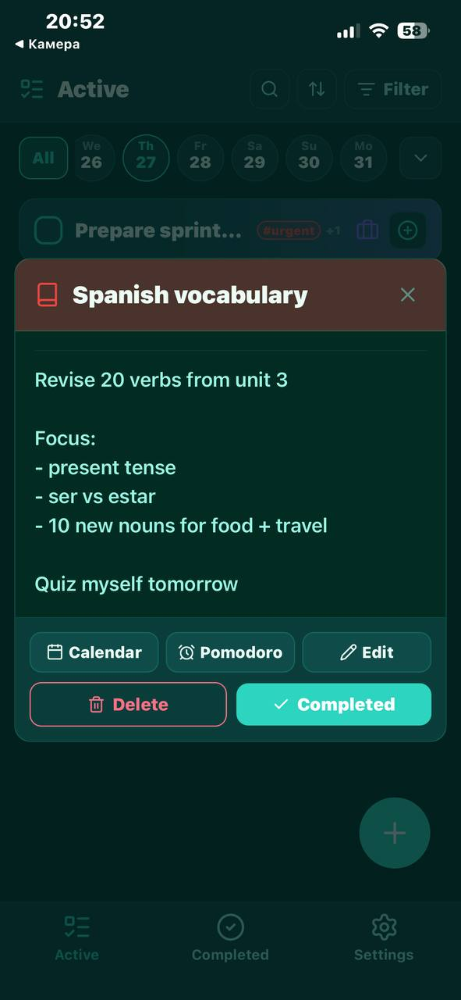
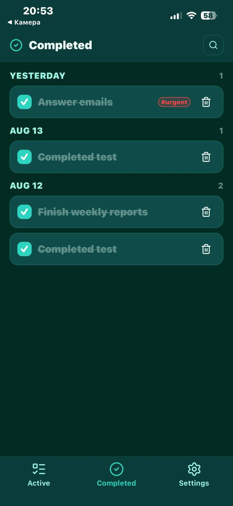
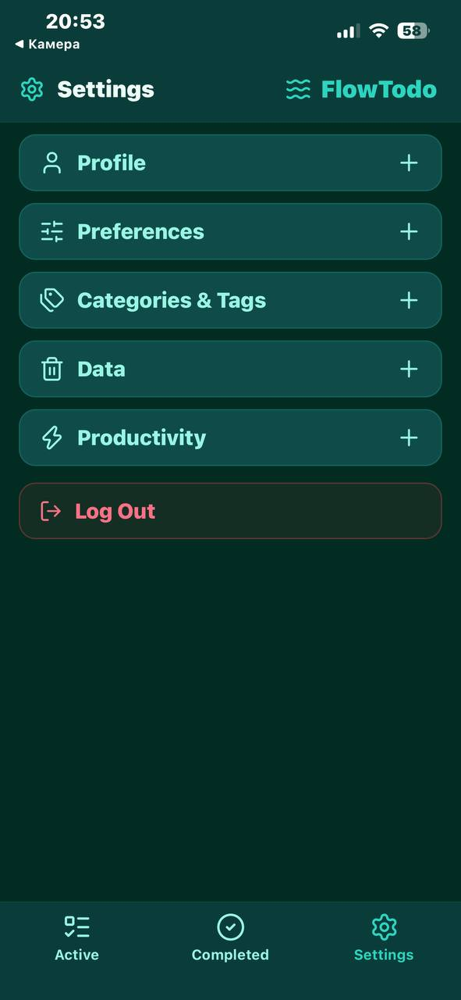
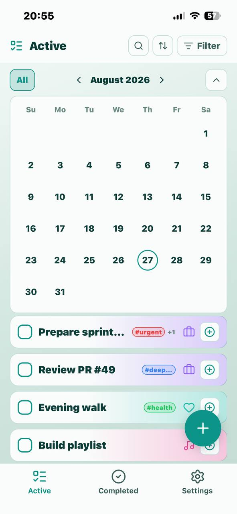

# FlowTodo

[English](README.md) · [Polski](README.pl.md) · **Українська**

Порт [NextTodo](https://github.com/matt400/NextTodo) на **Expo (React Native)** + **Supabase**: iOS, Android і веб з однієї кодової бази.

**Live (веб):** [flowtodo-expo-supabase.vercel.app](https://flowtodo-expo-supabase.vercel.app)  
**v1.0.1:** [Release](https://github.com/ep1cvoice/flowtodo-expo-supabase/releases/tag/v1.0.1) (APK додано до релізу).

## Скриншоти

| | |
|:--|:--|
|  |  |
| *Вхід* | *Активні* |
|  |  |
| *Деталі завдання* | *Виконані* |
|  |  |
| *Налаштування* | *Активні (світла тема)* |

## Статус

**v1.0**: основний сценарій підключено до Supabase (автентифікація, завдання, Pomodoro, налаштування).

| Область | Стан |
|---------|------|
| Автентифікація (вхід / реєстрація / сесія) | Supabase Auth + `profiles` |
| Зміна пароля / видалення акаунта | Налаштування + RPC `delete_own_account` |
| Тема + тривалість Pomodoro | Зберігається в `profiles` |
| Завдання / категорії / теги | Supabase + RLS; демо-дані для нових користувачів |
| Таймер Pomodoro + історія | Таблиця `pomodoros` + UI |
| Екран запуску | Брендований оверлей під час старту сесії |
| Перетягування / зміна порядку | Нативно: довге натискання; веб: ↑/↓; `sort_order` у БД |
| Тости | Глобальні `ToastContext` / `ToastHost` |
| Тактильний відгук | Перетягування, виконання, видалення (нативно) |
| Робота з мережею | Банер офлайн + повторне завантаження після відновлення мережі; мережеві тости |

## Стек

| Рівень | Вибір |
|--------|-------|
| Фреймворк | Expo SDK **57** + Expo Router |
| Менеджер пакетів | **Bun** (`bun.lock`); Node.js LTS усе ще потрібен для деяких команд Expo |
| UI | React Native + `react-native-web`, StyleSheet |
| Іконки | `lucide-react-native` |
| Автентифікація / БД | Supabase (`supabase-js`), сесія в AsyncStorage |
| Жести / DnD | `gesture-handler`, `reanimated`, `react-native-sortables` |
| Зворотний зв'язок | `expo-haptics`, власні тости |
| Звук | `expo-av` (сигнал Pomodoro) |

## Міграції Supabase

Порядок у `supabase/migrations/`:

1. `20260802120000_profiles.sql`: профіль + налаштування
2. `20260807120000_tasks_domain.sql`: завдання / категорії / теги + RLS
3. `20260807120100_grants.sql`: права (GRANT) для `authenticated`
4. `20260808120000_delete_own_account.sql`: RPC видалення акаунта
5. `20260810120000_pomodoros.sql`: сесії та історія Pomodoro
6. `20260812120000_tasks_completed_at.sql`: `completed_at` у завданнях
7. `20260812120100_filter_limits.sql`: спільний ліміт фільтрів (`max_filter_selections`, 5–30)

На новій базі запускайте міграції в цьому порядку (SQL Editor або CLI).

## Запуск

Встановіть [Bun](https://bun.sh/docs/installation), потім:

```bash
bun install
cp .env.example .env   # заповніть ключі локально
bun start -- -c
```

`w` = веб · Expo Go = QR-код у терміналі · SDK навмисно **57**, під актуальний Expo Go.

| Завдання | Команда |
|----------|---------|
| Dev-сервер | `bun start` |
| Android | `bun run android` |
| iOS | `bun run ios` |
| Веб | `bun run web` |
| Додати бібліотеку Expo | `bun expo install <pkg>` |

## APK для Android

```bash
bunx eas-cli login
bunx eas-cli build:configure   # один раз: прописує projectId Expo в app.json
bunx eas-cli env:set preview --name EXPO_PUBLIC_SUPABASE_URL --value "https://YOUR.supabase.co" --visibility plaintext --non-interactive
bunx eas-cli env:set preview --name EXPO_PUBLIC_SUPABASE_ANON_KEY --value "your_anon_key" --visibility sensitive --non-interactive
bunx eas-cli build -p android --profile preview
```

Профіль `preview` в `eas.json` збирає **APK** (не AAB). Після збірки Expo дає посилання для завантаження; на телефоні потрібно дозволити встановлення з невідомих джерел. EAS використовує Bun, бо в репозиторії є `bun.lock`.

## Веб (Vercel)

Push у `main` запускає деплой. Змінні середовища на Vercel (під час збірки): `EXPO_PUBLIC_SUPABASE_URL`, `EXPO_PUBLIC_SUPABASE_ANON_KEY`. Конфігурація: `vercel.json`.

## Тести

```bash
bun run test
```

Використовуйте `bun run test`, а не `bun test`: друге запускає власний раннер Bun, а не Jest.

Стек: **Jest** + **jest-expo** + **@testing-library/react-native**.  
Обов'язкове покриття зараз: валідація автентифікації (+ smoke-тест входу), мережеві помилки, мапери завдань і Pomodoro, зміна порядку з фільтрами, банер офлайн.
